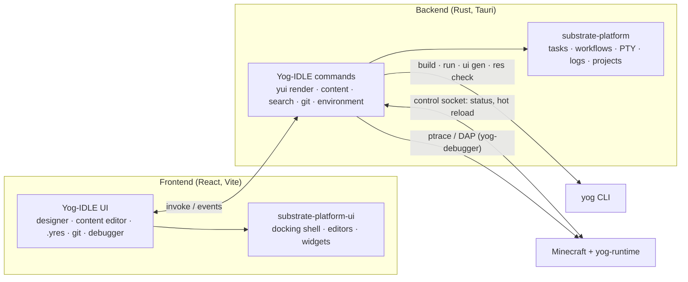

<div align="center">

<a id="top"></a>

# 🧪 Yog-IDLE

### The IDE for Yog Minecraft mods: design, build, run, debug, hot-reload

[](LICENSE)
[](COMMERCIAL-LICENSE.md)
[](https://tauri.app/)
[](https://react.dev/)
[](rust-toolchain.toml)


🇺🇸 **English** | 🇷🇺 [Русский](README.ru.md)

[Overview](#-overview) • [Features](#-key-features) • [Formats](#-file-formats) • [Getting Started](#-getting-started) • [Architecture](#-architecture) • [Status](#-status) • [Docs](#-documentation)

</div>

---

## 📖 Overview

**Yog-IDLE** is a desktop IDE for mods built on the
[Yog mod loader](https://github.com/F000NKKK/Yog-Mod-Loader). It is laid out
like Visual Studio: Project Explorer, editor tabs, Properties, Toolbox,
Document Outline, Output and Terminal. On top of that it has editors made for
Yog's own file types:

- a **screen designer** for `.yui` screens and components,
- a **3D model editor with a paint mode** for `.yblock` / `.yitem` blocks and items,
- a **resource table** for `.yres` texts and images in every language,
- plus build, run, a **native debugger** and **hot reload** into a running game.

It is a [Tauri](https://tauri.app/) app (Rust backend, React frontend) built
on [Substrate Platform](https://github.com/F000NKKK/Substrate-Platform), a
generic IDE core with a docking shell, editors and widgets.

<!-- screenshot: docs/images/overview.png — the whole IDE with Yog-Modlist open: Project Explorer, mod_list.yui in the designer, Properties, Output -->

### 🎯 Why Yog-IDLE?

- **👀 What you see is what the game draws.** The designer renders screens
  with `yog-ui` itself, the same crate mods use, with Minecraft's own font
  and textures read from your local client jar.
- **🔁 Markup and canvas stay in sync.** Edit the XAML or drag on the canvas;
  both panes update, and one undo stack covers both.
- **🧱 Blocks and items without Blockbench.** Model, texture and paint a
  block in the IDE, and the result is a `.yblock` that `yog build` turns into
  Minecraft assets.
- **🐞 Real debugging.** Breakpoints, stepping, call stacks and variables in
  the mod's Rust code while the game runs.

## 🌟 Key Features

### 🖼️ Screen designer (`.yui`)
- Design and XAML side by side, with two-way sync, selection sync and XAML completion
- Toolbox, rubber-band selection, move/resize handles, snaplines, a 2px grid,
  arrow-key nudging, cut/copy/paste, z-order, undo/redo
- **WPF-style `Grid` editing**: row/column rails with sizes (`Auto`, `*`, px),
  click to split, drag to resize, a Row/ColumnDefinition editor, drop into a cell
- **Components**: the mod's `<Component>` files appear in the Toolbox, and
  instances are drawn for real. Components with code are built for the host
  machine and rendered in a separate process, so a crash can't take down the IDE
- **Image sources** picker: `item:`, `block:`, `sprite:`, `mod:` and the mod's
  own textures, with previews
- **Preview mode**: hover and click buttons, scroll lists and type into text
  boxes as in game. Events are logged instead of run
- Double-click a control to jump to its handler in the code-behind

<!-- screenshot: docs/images/screen-designer.png — Yog-Modlist's mod_list.yui, Design + XAML split, the outer Grid selected so the row/column rails show -->

### 🧊 Block and item editor (`.yblock` / `.yitem`)
- 3D viewport with orbit, pan, zoom, numpad views and Minecraft face shading
- Outliner, **Move (G)** and **Resize (S)** handles with pixel snapping,
  rotation limited to what Minecraft allows
- UV editor, display-slot preview (gui, ground, hand, head...), block-state
  variants, item model and connection-arm models
- **Paint (P)**: paint on the model or in the 2D texture view with pencil,
  eraser, fill, color picker, line and rectangle tools, mirror X, palette and
  recent colors. **New Texture...** creates a blank 16/32/64 px texture.
  Vanilla textures are copied into the mod on the first stroke
- Sprite items open in Paint with layers; **Convert to 3D Elements** extrudes a sprite into a model
- **Project › Import...** imports resource-pack and Blockbench models

<!-- screenshot: docs/images/content-editor.png — a .yblock (e.g. HexMod-Yog's slate) in the 3D view with an element selected and the Move handles visible -->
<!-- screenshot: docs/images/paint-mode.png — Paint mode on a block: 3D view and 2D texture view side by side, the paint tool strip and palette visible -->

### 🌍 Resource editor (`.yres`)
- A ResX-style grid (Name | Value | Type | Comment) with type-aware editors:
  color picker, file picker with thumbnails, numbers, checkboxes
- **All Languages** shows a column per culture variant (`Strings.ru_ru.yres`,
  ...) and highlights untranslated texts; **Add Language...** creates a new one
- Validation (bad names, duplicate keys, wrong types), search, spreadsheet copy/paste
- Saving regenerates `<Set>.g.rs`, which is shown nested under the `.yres`

<!-- screenshot: docs/images/yres-editor.png — Yog-Modlist's Strings.yres with All Languages on (English + Russian columns) -->

### ▶️ Build, run and debug
- **Build** runs `yog build`. Saved **publish profiles** package a `.yog` or run `yog publish exports`
- **Run** targets come from `[run.<name>]` in `yog.toml`, in Release or Debug.
  The status bar shows the game's pid and loaded mods
- **Hot reload**: rebuild and swap the mod into the running game (the ABI must not change)
- **Debugger** (`yog-debugger`, ptrace + DAP): gutter breakpoints, Break All
  (pauses only the render and server threads), step over/into/out, per-thread
  call stack with **Just My Code**, Locals, **Watch** expressions and value
  tooltips on hover
- **Output** keeps a separate source per producer (Build, Run, Debug, Game, Source Control...)

<!-- screenshot: docs/images/debugger.png — stopped at a breakpoint in a mod's Rust code: call stack, Locals and Watch panels visible -->

### 🧰 Everything else an IDE needs
- CodeMirror editors with tab pinning and Markdown preview (GFM, KaTeX, Mermaid)
- **Properties** grid for the project, `yog.toml` entries and files, written
  back with formatting preserved; **Project Properties** pages
- **Git**: Git Changes and Git Repository windows, branches, diffs,
  fetch/pull/push, all through your own `git` and its config
- **Code Search** (Ctrl+T) over files and Rust symbols, plus **Find/Replace in Files**
- **Environment** installer: finds or installs `yog`, rustup targets, Zig,
  `cargo-zigbuild` and the JDKs, like the Visual Studio Installer
- Integrated terminals (xterm.js on a real PTY), a settings window, and an English or Russian UI

## 📄 File Formats

| File | Opens in | Format reference |
|---|---|---|
| `src/**/*.yui` (`<Screen>` / `<Component>`) | Screen designer + XAML | [docs/yui.md](docs/yui.md) |
| `.yui` with `x:ViewModel` | Same, compiled to a yog-kit view | [docs/mvvm.md](docs/mvvm.md) |
| `resources/**/*.yres` | Resource table | [docs/yres.md](docs/yres.md) |
| `content/**/*.yblock`, `*.yitem` | 3D model editor + paint | [docs/blocks-items.md](docs/blocks-items.md) |
| `yog.toml` | Properties grid / text | [Yog-Mod-Loader README](https://github.com/F000NKKK/Yog-Mod-Loader#-quick-start) |

Every editor keeps a text view: **F7** (or the code button) switches to the
underlying XML/JSON.

## 🚀 Getting Started

Yog-IDLE depends on Substrate-Platform through relative paths, so clone both
side by side:

```bash
git clone https://github.com/F000NKKK/Substrate-Platform.git
git clone https://github.com/F000NKKK/Yog-IDLE.git

(cd Substrate-Platform/ui && npm install)
cd Yog-IDLE
npm install
npm run tauri dev        # development build with hot module reload
npm run tauri build      # release bundle
```

To work on mods you also need the `yog` CLI (`cargo install yog-cli`), and for
running the game a [Yog-Mod-Loader](https://github.com/F000NKKK/Yog-Mod-Loader)
checkout with JDK 17/21. **Tools › Check Environment...** finds what's
missing and **Tools › Install Components...** installs it.

Then use **File › Open Folder** on a folder with a `yog.toml`.
[Yog-Modlist](https://github.com/F000NKKK/Yog-Modlist) is a good first project:
it has a view-model screen, two components and translated resources.

## 📐 Architecture



- `src/` is the React frontend (`designer/`, `content/`, `editors/`, `git/`,
  `search/`, `debugger/`, `panels/`...).
- `src-tauri/` is the Rust backend. The designer's `yui` renderer builds the
  same `yog-ui` widget tree a mod's generated code builds, and rasterizes it
  with Minecraft's font and textures.
- Generic pieces (docking, editors, DataGrid, PropertyGrid, terminal, task
  runner) belong in Substrate Platform. Yog-specific features stay in this repo.

## 🚧 Status

Active development, used daily on Linux.

- **Works**: everything listed above.
- **Linux only**: debugging (`ptrace`), hot reload and the in-game status
  bar (the runtime's Unix control socket).
- **Planned**: live preview of a designed screen in the running game (the
  route is hot reload of the regenerated code); debugging and hot reload on
  Windows and macOS.

## 📚 Documentation

- [docs/yui.md](docs/yui.md): `.yui` screens: elements, sizing, `Grid`, images, components, the designer
- [docs/mvvm.md](docs/mvvm.md): view-model screens with yog-kit: bindings, commands, lists, styles, testing
- [docs/yres.md](docs/yres.md): `.yres` resources, translations, generated accessors
- [docs/blocks-items.md](docs/blocks-items.md): `.yblock` / `.yitem`, models, import, the 3D editor

## 📄 License

Dual-licensed: **AGPL-3.0-only** ([LICENSE](LICENSE)), free for any use that
complies with the AGPL, or a **Commercial License** for closed-source use,
free below $1,000/month net profit with a sliding royalty above that. See
[COMMERCIAL-LICENSE.md](COMMERCIAL-LICENSE.md).

---

<div align="center">

**[⬆ Back to Top](#top)**

Part of the [Yog](https://github.com/F000NKKK/Yog-Mod-Loader) project

</div>
