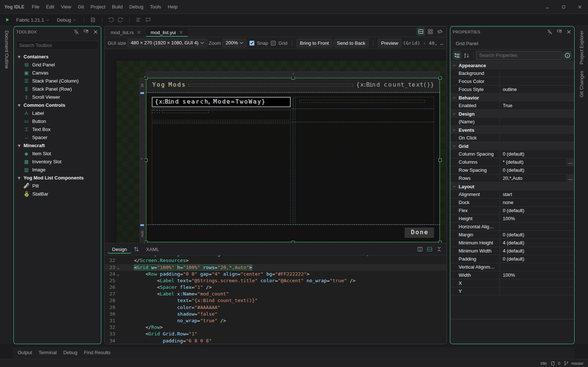
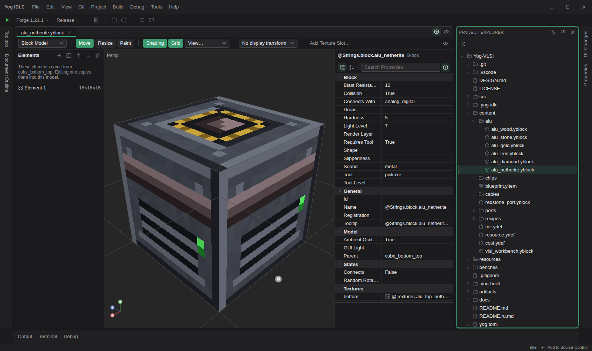
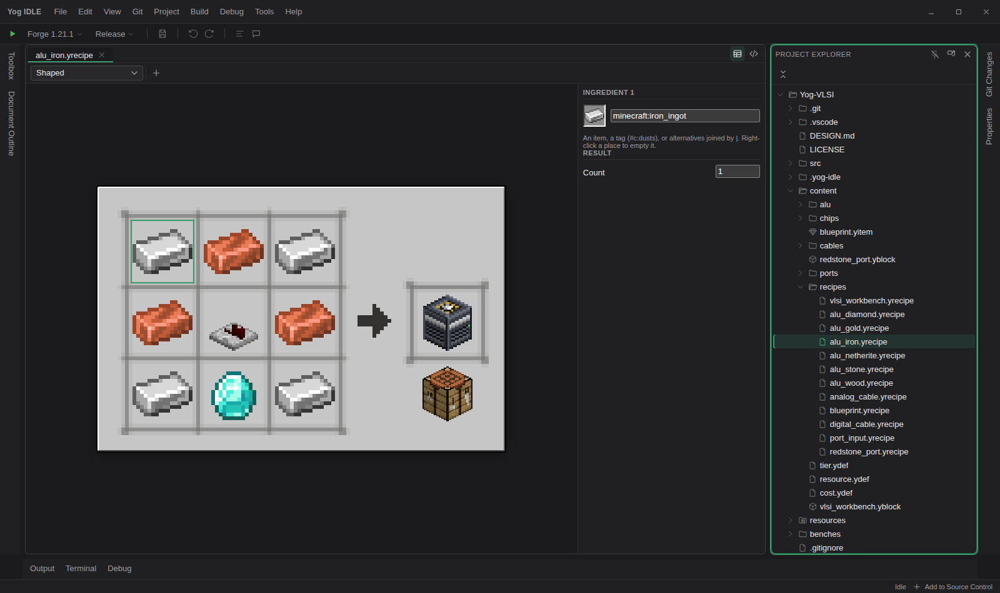
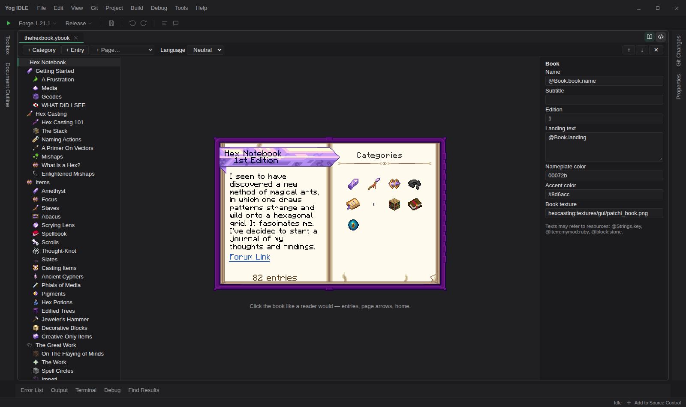
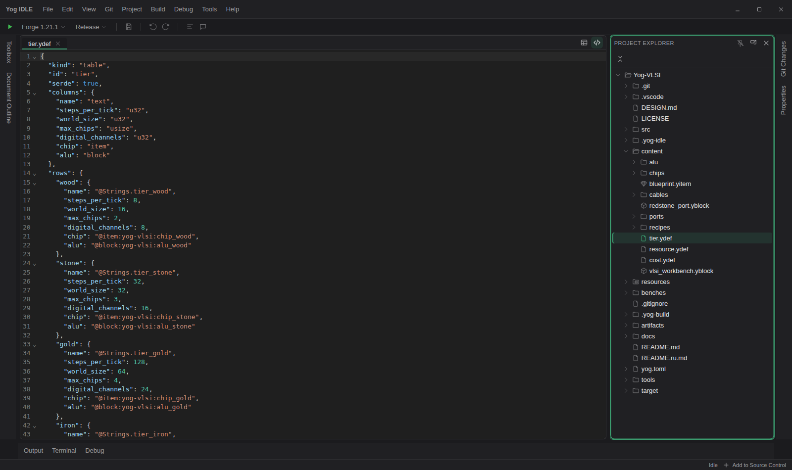

<div align="center">

<a id="top"></a>


# Yog IDLE

**The IDE for Yog Minecraft mods — design, build, run, debug and hot-reload in one place**

[](https://github.com/F000NKKK/Yog-IDLE/releases/latest)
[](LICENSE)
[](COMMERCIAL-LICENSE.md)


**English** · [Русский](README.ru.md)

[Download](#-download) · [Tour](#-a-tour) · [Getting started](#-getting-started) · [Building from source](#-building-from-source) · [Contributing](CONTRIBUTING.md)

</div>

---

Yog IDLE is a desktop IDE for mods made with the
[Yog mod loader](https://github.com/F000NKKK/Yog-Mod-Loader). It looks and
works like Visual Studio — Project Explorer, tabs, Properties, Toolbox, Output,
Terminal — and adds a visual editor for every kind of file a Yog mod has:
screens, blocks, items, recipes, guide books, models and animations, sounds,
particles, videos, terrain, translations and data tables.
What you see in an editor is drawn by the same code the game runs.

<p align="center"></p>

## 📦 Download

Install it with [Yog Installer](https://github.com/F000NKKK/Yog-Installer/releases/latest)
— like Visual Studio Installer, it installs IDLE together with everything a
mod needs (the Yog CLI, Rust and the build targets for every platform, Zig,
the JDKs for Minecraft, the loader SDK), keeps them up to date, and updates
IDLE itself. Everything goes into your user folder (`~/.yog`), without
administrator rights.

IDLE's own packages are on the [Releases](https://github.com/F000NKKK/Yog-IDLE/releases/latest)
page too (Windows .exe/.msi, Linux .deb/.rpm/AppImage, macOS universal
.dmg); then **Tools › Yog Installer...** sets up the rest.

## 🧭 A tour

### Screens

Screens and components are written in a XAML-like markup. The designer shows
the markup and the canvas side by side and keeps them in sync: drag a button
and the markup changes, edit the markup and the canvas redraws. Everything is
drawn with Minecraft's own font and textures from your game, including
styles, themes, lists and your own components. The preview mode lets you
click buttons, scroll lists and type into text boxes as in the game.

### Blocks and items

A 3D model editor made for Minecraft: orbit, pan and zoom the model, move and
resize its elements with pixel snapping, edit UVs, block states and how the
item is held. Every property of a block — hardness, tool, light, sound,
drops — is in the property grid on the right.

<p align="center"></p>

Press **P** to paint right on the model or on the flat texture, with a pencil,
fill, line, rectangle, mirror and a palette. Sprite items get layers and can
be turned into a 3D model in one click. Resource-pack and Blockbench models
can be imported.

<p align="center"></p>

### Recipes

Crafting recipes are edited on a crafting table: drop items into the slots,
set the result and its count. Shaped, shapeless and furnace recipes have their
own views; any other kind, including kinds your mod defines, opens as text.

<p align="center"></p>

### Guide books

The guide book designer draws the book with the renderer the game uses. Click
it like a player would — categories, entries, page arrows — and the outline on
the left follows. Add and reorder categories, entries and pages, edit them in
the property grid, and switch the language to read every translation.

<p align="center"></p>

### Models, animations and entities

`.ymodel` skeletons, `.yanim` animations and a mod's entities have their own
editors: pose the bones, key the timeline, and see the entity as the game
draws it (yog-body).

### Sounds, particles and video

- **Sounds**: a small DAW for `.ysound` — variants, waveforms, a mixer and
  montage, played as the game plays them.
- **Particles**: `.yparticle` look, behaviour and rendering with a live preview.
- **Video**: `.yvideo` with a montage designer — clips, picture lanes and a
  player — for screens, the world, cutscenes and entities.
- **Textures**: pictures in any format, edited and written as the game takes them.

### Terrain

Declarative terrain (yog-worldgen) — noise, layers, caves and ores — is
previewed as the game generates it, while its table is edited.

### Texts, translations and data tables

Resources are a table of names and values: texts, colors, numbers, images and
sounds. **All Languages** puts every translation in its own column and marks
the missing ones. Saving generates typed accessors for the mod's code.

<p align="center"></p>

Data tables — tiers, costs, any list of records a mod declares — open in the
code editor; a mod gets typed access to their rows.

<p align="center"></p>

### Build, run and debug

- **Build** packages the mod for all five platforms at once.
- **Run** starts Minecraft with your mod on Fabric, NeoForge or Forge, in
  Release or Debug.
- **Hot reload** rebuilds the mod and swaps it (and, if asked, its
  resources) into the running game over the game's control channel.
- The **debugger** stops at breakpoints in the mod's Rust code while the game
  runs: step, call stack, locals, watch expressions and values on hover.
- Every format is read, written and checked through the Yog CLI
  (`yog serve`), so IDLE shows the same problems `yog check` reports.

<p align="center"></p>

### And the rest of an IDE

Code editors with Markdown preview, Git (changes, branches, diffs, push and
pull), code search by file and symbol, find and replace in files, integrated
terminals, an English and a Russian interface, and settings for everything.
What's installed is Yog Installer's; a machine's own overrides — a loader
checkout, its JDKs, its graphics card — go in `~/.yog/local.toml`.

## 🚀 Getting started

1. Install IDLE with Yog Installer (workload *Mod development*).
2. **File › Open Folder** on a mod — a folder with a yog.toml.
   [Yog-Modlist](https://github.com/F000NKKK/Yog-Modlist) is a small one to
   start with; [Yog-VLSI](https://github.com/F000NKKK/Yog-VLSI) uses every
   editor.
3. Pick a loader and a Minecraft version in the toolbar and press ▶.

The formats are described in [docs](docs): [screens](docs/yui.md),
[view models](docs/mvvm.md), [resources](docs/yres.md),
[blocks and items](docs/blocks-items.md), [books](docs/books.md).

## 🛠 Building from source

IDLE is built with [Tauri](https://tauri.app/) (Rust and React) on top of
[Substrate Platform](https://github.com/F000NKKK/Substrate-Platform), so clone
the two side by side:

```bash
git clone https://github.com/F000NKKK/Substrate-Platform.git
git clone https://github.com/F000NKKK/Yog-IDLE.git
(cd Substrate-Platform/ui && npm install)
cd Yog-IDLE && npm install
npm run tauri dev      # run with hot module reload
npm run tauri build    # make the installers
```

## 🤝 Contributing

Bug reports, ideas and pull requests are welcome — see
[CONTRIBUTING.md](CONTRIBUTING.md). Security issues go privately, as described in
[SECURITY.md](SECURITY.md).

## 📄 License

Free under the [AGPL-3.0](LICENSE). A [commercial license](COMMERCIAL-LICENSE.md)
is available for closed-source use, free below $1,000 a month of net profit.

<div align="center">

Part of the [Yog](https://github.com/F000NKKK/Yog-Mod-Loader) project · [Back to top](#top)

</div>
