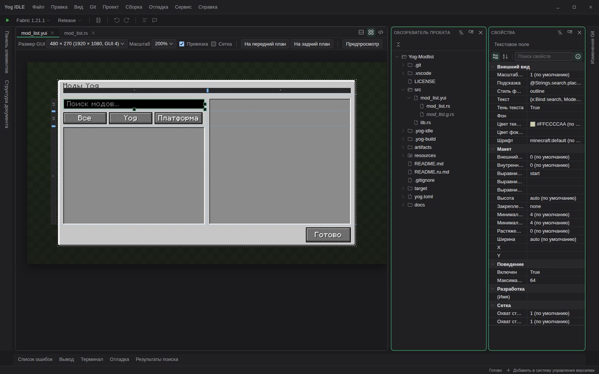
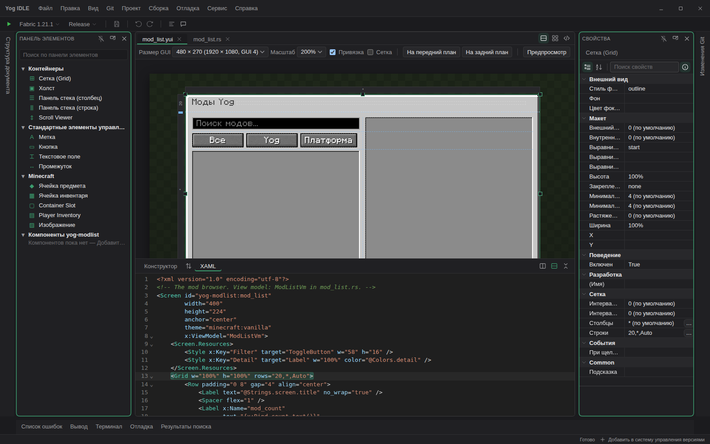
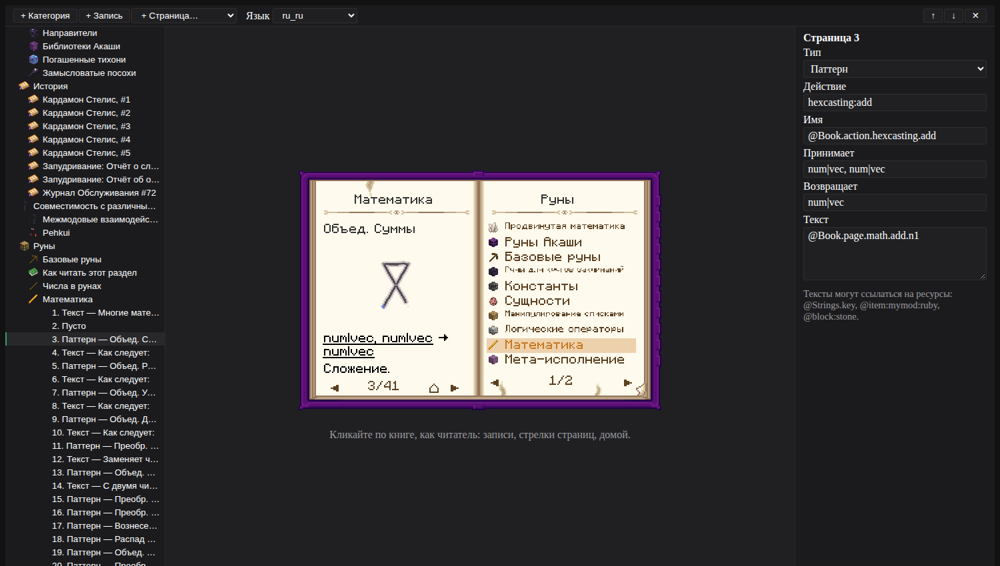
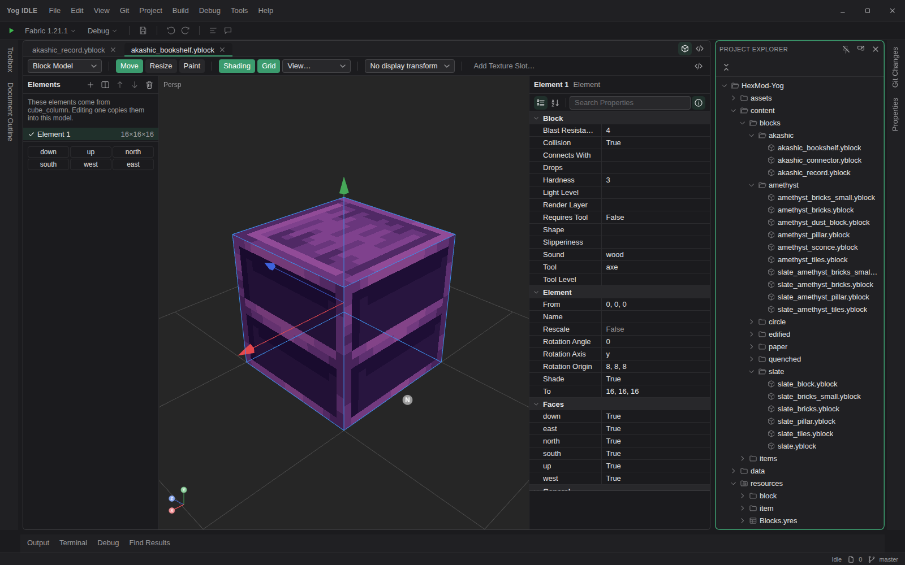
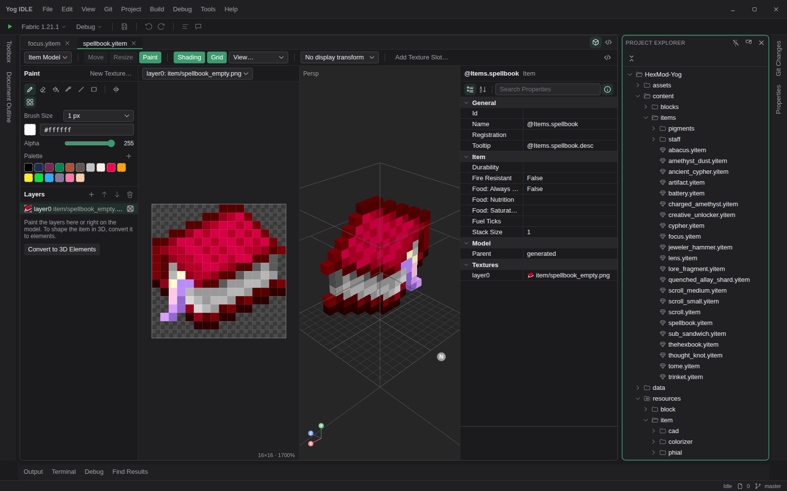
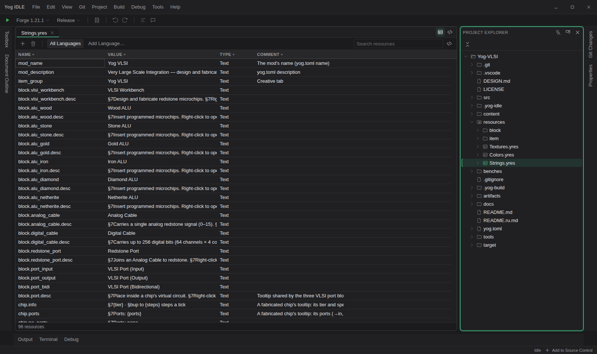
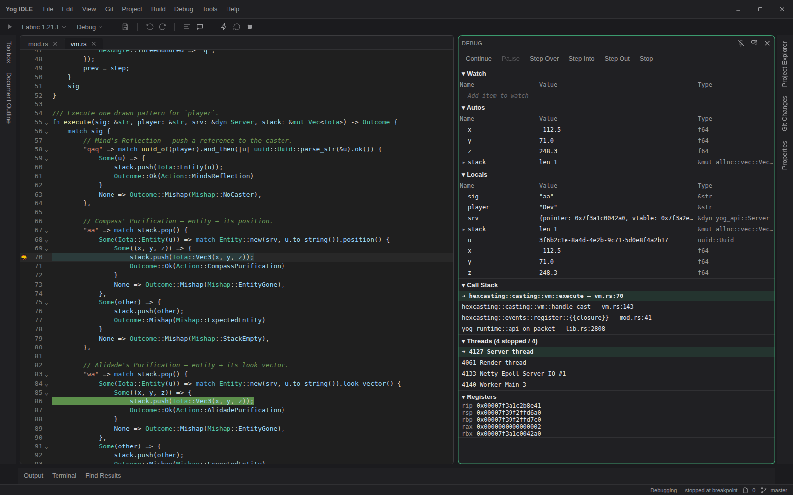
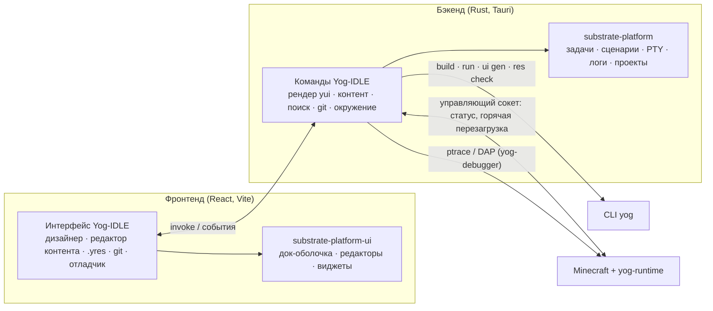

<div align="center">

<a id="top"></a>

# 🧪 Yog-IDLE

### IDE для модов Yog: дизайн, сборка, запуск, отладка и горячая перезагрузка

[](LICENSE)
[](COMMERCIAL-LICENSE.md)
[](https://tauri.app/)
[](https://react.dev/)
[](rust-toolchain.toml)


🇺🇸 [English](README.md) | 🇷🇺 **Русский**

[Обзор](#-обзор) • [Возможности](#-ключевые-возможности) • [Форматы](#-форматы-файлов) • [Начало работы](#-начало-работы) • [Архитектура](#-архитектура) • [Статус](#-статус) • [Документация](#-документация)

</div>

---

## 📖 Обзор

**Yog-IDLE** — десктопная IDE для модов на
[загрузчике Yog](https://github.com/F000NKKK/Yog-Mod-Loader). Устроена она
как Visual Studio: обозреватель проекта, вкладки редакторов, свойства, панель
элементов, структура документа, вывод и терминал. Кроме того, у неё есть
редакторы для собственных форматов Yog:

- **дизайнер экранов** для экранов и компонентов `.yui`;
- **3D-редактор моделей с режимом рисования** для блоков и предметов `.yblock` / `.yitem`;
- **таблица ресурсов** для текстов и картинок `.yres` на всех языках;
- а также сборка, запуск, **нативный отладчик** и **горячая перезагрузка** в запущенную игру.

Это приложение на [Tauri](https://tauri.app/) (бэкенд на Rust, фронтенд на
React), построенное на [Substrate Platform](https://github.com/F000NKKK/Substrate-Platform) —
универсальном ядре IDE с док-оболочкой, редакторами и виджетами.

<p align="center"></p>

### 🎯 Почему Yog-IDLE?

- **👀 Что видно в дизайнере, то и нарисует игра.** Дизайнер рисует экраны
  самим `yog-ui` — тем же крейтом, что и моды, — шрифтом и текстурами
  Minecraft из вашего локального клиента.
- **🔁 Разметка и холст всегда совпадают.** Правьте XAML или двигайте
  элементы на холсте: обновляются обе панели, а отмена общая.
- **🧱 Блоки и предметы без Blockbench.** Модель, текстура и рисование прямо в
  IDE. Получается файл `.yblock`, который `yog build` превращает в ассеты Minecraft.
- **🐞 Настоящая отладка.** Точки останова, пошаговое выполнение, стек вызовов
  и переменные в Rust-коде мода прямо во время игры.

## 🌟 Ключевые возможности

### 🖼️ Дизайнер экранов (`.yui`)
- Дизайн и XAML рядом, с двусторонней синхронизацией, синхронным выделением
  и автодополнением в XAML
- Панель элементов, выделение рамкой, маркеры перемещения и размера,
  направляющие, сетка 2px, сдвиг стрелками, вырезать/копировать/вставить,
  порядок слоёв, отмена и повтор
- **`Grid` в стиле WPF**: линейки строк и столбцов с размерами (`Auto`, `*`,
  px). Щелчок делит строку или столбец, перетаскивание меняет размер, есть
  редактор Row/ColumnDefinition, а элементы бросаются прямо в ячейку
- **Компоненты**: файлы `<Component>` мода появляются в панели элементов, а
  их экземпляры рисуются по-настоящему. Компоненты с кодом собираются под
  текущую машину и рисуются в отдельном процессе, так что падение мода не
  уронит IDE
- Выбор **источника картинки**: `item:`, `block:`, `sprite:`, `mod:` и
  текстуры самого мода, с превью
- **Режим просмотра**: кнопки нажимаются, списки прокручиваются, в поля можно
  печатать, как в игре. События не выполняются, а записываются в лог
- Двойной щелчок по контролу открывает его обработчик в коде экрана
- **Рисуется так, как экран соберёт игра**: стили `<Screen.Resources>` (с
  `based_on`) и значения, тема экрана, `ToggleButton`, `ListView` и
  `ItemsControl` из yog-kit. Привязанное значение показывает значение для
  дизайнера `d:` (`d:text="Пример"`) или ничего — тогда поле ввода показывает
  подсказку
- **Ctrl+колесо** (или щипок) масштабирует вокруг курсора, до 800%

<p align="center"></p>

### 📕 Дизайнер книг (`.ybook`)
- Книгу-руководство рисует сам yog-book — тот же рендерер, что в игре, — шрифтом
  и текстурами игры. По книге можно кликать как читатель (категории, записи,
  стрелки страниц, домой), и дерево следует за ней
- Дерево категорий, записей и страниц: добавление, удаление, порядок; таблица
  свойств выбранного; каждая правка видна сразу
- Переключатель **«Язык»**: книга на любом языке, на который переведены её
  тексты `.yres`, вместе с названиями предметов и существ
- Сетки крафта с 3D-блоками, рецепты и модели блоков самого мода, существа,
  мультиструктуры и руны, с анимацией как в игре

<p align="center"></p>

### 🍳 Редактор рецептов (`.yrecipe`)
- Рецепты Yog в виде верстака (с формой и без) или печи: перетащите предметы
  в слоты. Остальные виды (доменная печь, камнерез, кузнечный стол…)
  редактируются в JSON (F7)

### 🧊 Редактор блоков и предметов (`.yblock` / `.yitem`)
- 3D-вид с вращением, сдвигом, масштабом, видами с цифровой клавиатуры и
  затенением граней как в Minecraft
- Список элементов, маркеры **Move (G)** и **Resize (S)** с привязкой к
  пикселям, повороты только в пределах, которые допускает Minecraft
- Редактор UV, просмотр слотов отображения (GUI, земля, рука, голова...),
  варианты состояний блока, модель предмета и модель соединения
- **Рисование (P)**: прямо по модели или во 2D-виде текстуры. Есть карандаш,
  ластик, заливка, пипетка, линия, прямоугольник, зеркало по X, палитра и
  недавние цвета. **New Texture...** создаёт пустую текстуру 16/32/64 px.
  Ванильная текстура при первом мазке копируется в мод
- Плоские предметы открываются в режиме рисования со слоями. **Convert to
  3D Elements** превращает спрайт в объёмную модель
- **Project › Import...** импортирует модели из ресурспаков и Blockbench

<p align="center"></p>

<p align="center"></p>

### 🌍 Редактор ресурсов (`.yres`)
- Таблица в стиле ResX (Name | Value | Type | Comment) с редактором под каждый
  тип: выбор цвета, выбор файла с миниатюрами, числа, флажки
- **All Languages** показывает по столбцу на каждый язык (`Strings.ru_ru.yres`,
  ...) и подсвечивает непереведённое. **Add Language...** добавляет новый язык
- Проверки (плохие имена, повторяющиеся ключи, неверные типы), поиск,
  копирование и вставка из таблиц
- При сохранении перегенерируется `<Set>.g.rs`; он виден вложенным под `.yres`

<p align="center"></p>

### ▶️ Сборка, запуск и отладка
- **Сборка** запускает `yog build`. Сохранённые **профили публикации**
  упаковывают `.yog` или выполняют `yog publish exports`
- **Цели запуска** берутся из `[run.<name>]` в `yog.toml`, в режиме Release или
  Debug. В строке состояния видны pid игры и загруженные моды
- **Горячая перезагрузка**: пересобрать мод и подменить его в запущенной игре
  (ABI при этом меняться не должен)
- **Отладчик** (`yog-debugger`, ptrace + DAP): точки останова на полях
  редактора, Break All (останавливает только потоки рендера и сервера), шаги
  с заходом и без, выход из функции, стек вызовов по потокам с **Just My
  Code**, Locals, выражения **Watch** и значения во всплывающих подсказках
- **Вывод** разделён по источникам (Build, Run, Debug, Game, Source Control...)

<p align="center"></p>

### 🧰 Всё остальное, что нужно IDE
- Редакторы на CodeMirror с закреплением вкладок и предпросмотром Markdown (GFM, KaTeX, Mermaid)
- Таблица **свойств** для проекта, записей `yog.toml` и файлов; правки
  записываются с сохранением форматирования. Есть страницы **свойств проекта**
- **Git**: окна Git Changes и Git Repository, ветки, диффы, fetch/pull/push —
  через ваш собственный `git` и его настройки
- **Code Search** (Ctrl+T) по файлам и символам Rust, а также **поиск и замена в файлах**
- Установщик **окружения**: находит или ставит `yog`, таргеты rustup, Zig,
  `cargo-zigbuild` и JDK, как Visual Studio Installer
- Встроенные терминалы (xterm.js на настоящем PTY), окно настроек, интерфейс на английском или русском

## 📄 Форматы файлов

| Файл | Где открывается | Описание формата |
|---|---|---|
| `src/**/*.yui` (`<Screen>` / `<Component>`) | Дизайнер экранов + XAML | [docs/yui.md](docs/yui.md) |
| `.yui` с `x:ViewModel` | То же, компилируется в представление yog-kit | [docs/mvvm.md](docs/mvvm.md) |
| `resources/**/*.yres` | Таблица ресурсов | [docs/yres.md](docs/yres.md) |
| `content/**/*.yblock`, `*.yitem` | 3D-редактор + рисование | [docs/blocks-items.md](docs/blocks-items.md) |
| `content/**/*.ybook` | Дизайнер книг | [docs/books.md](docs/books.md) |
| `content/**/*.yrecipe` | Редактор рецептов | [README Yog-Mod-Loader](https://github.com/F000NKKK/Yog-Mod-Loader/blob/master/README.ru.md) |
| `yog.toml` | Таблица свойств / текст | [README Yog-Mod-Loader](https://github.com/F000NKKK/Yog-Mod-Loader/blob/master/README.ru.md#-быстрый-старт) |

У каждого редактора есть текстовый вид: **F7** (или кнопка с кодом)
показывает исходный XML или JSON.

Документация по форматам написана на английском.

## 🚀 Начало работы

Yog-IDLE подключает Substrate-Platform по относительным путям, поэтому оба
репозитория клонируются рядом:

```bash
git clone https://github.com/F000NKKK/Substrate-Platform.git
git clone https://github.com/F000NKKK/Yog-IDLE.git

(cd Substrate-Platform/ui && npm install)
cd Yog-IDLE
npm install
npm run tauri dev        # сборка для разработки с горячей заменой модулей
npm run tauri build      # релизная сборка
```

Для работы с модами нужна утилита `yog` (`cargo install yog-cli`), а для
запуска игры — чекаут [Yog-Mod-Loader](https://github.com/F000NKKK/Yog-Mod-Loader)
и JDK 17/21. **Tools › Check Environment...** покажет, чего не хватает, а
**Tools › Install Components...** доустановит недостающее.

Затем откройте папку с `yog.toml` через **File › Open Folder**. Для начала
хорошо подойдёт [Yog-Modlist](https://github.com/F000NKKK/Yog-Modlist): в нём
есть экран с моделью представления, два компонента и переведённые ресурсы.

## 📐 Архитектура



- `src/` — фронтенд на React (`designer/`, `content/`, `editors/`, `git/`,
  `search/`, `debugger/`, `panels/`...).
- `src-tauri/` — бэкенд на Rust. Рендерер `yui` в дизайнере строит то же
  дерево виджетов `yog-ui`, что и сгенерированный код мода, и растеризует
  его шрифтом и текстурами Minecraft.
- Универсальные части (док-оболочка, редакторы, DataGrid, PropertyGrid,
  терминал, запуск задач) живут в Substrate Platform. Всё, что касается
  Yog, остаётся в этом репозитории.

## 🚧 Статус

Активная разработка; IDE каждый день используется на Linux.

- **Работает**: всё перечисленное выше.
- **Только Linux**: отладка (`ptrace`), горячая перезагрузка и статус игры
  в строке состояния (Unix-сокет runtime).
- **В планах**: живой просмотр редактируемого экрана в запущенной игре
  (через горячую перезагрузку перегенерированного кода), отладка и горячая
  перезагрузка на Windows и macOS.

## 📚 Документация

- [docs/yui.md](docs/yui.md): экраны `.yui` — элементы, размеры, `Grid`, картинки, компоненты, дизайнер
- [docs/mvvm.md](docs/mvvm.md): экраны с моделью представления на yog-kit — привязки, команды, списки, стили, тесты
- [docs/yres.md](docs/yres.md): ресурсы `.yres`, перевод, сгенерированные методы доступа
- [docs/blocks-items.md](docs/blocks-items.md): `.yblock` / `.yitem`, модели, импорт, 3D-редактор

## 📄 Лицензия

Двойное лицензирование: **AGPL-3.0-only** ([LICENSE](LICENSE)) — бесплатно
для любого использования по правилам AGPL, или **коммерческая лицензия** для
закрытого использования: бесплатно при чистой прибыли до $1 000 в месяц, выше
— со скользящими отчислениями. Подробности в
[COMMERCIAL-LICENSE.md](COMMERCIAL-LICENSE.md).

---

<div align="center">

**[⬆ Наверх](#top)**

Часть проекта [Yog](https://github.com/F000NKKK/Yog-Mod-Loader)

</div>
