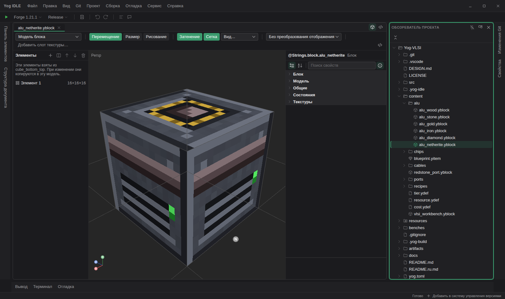
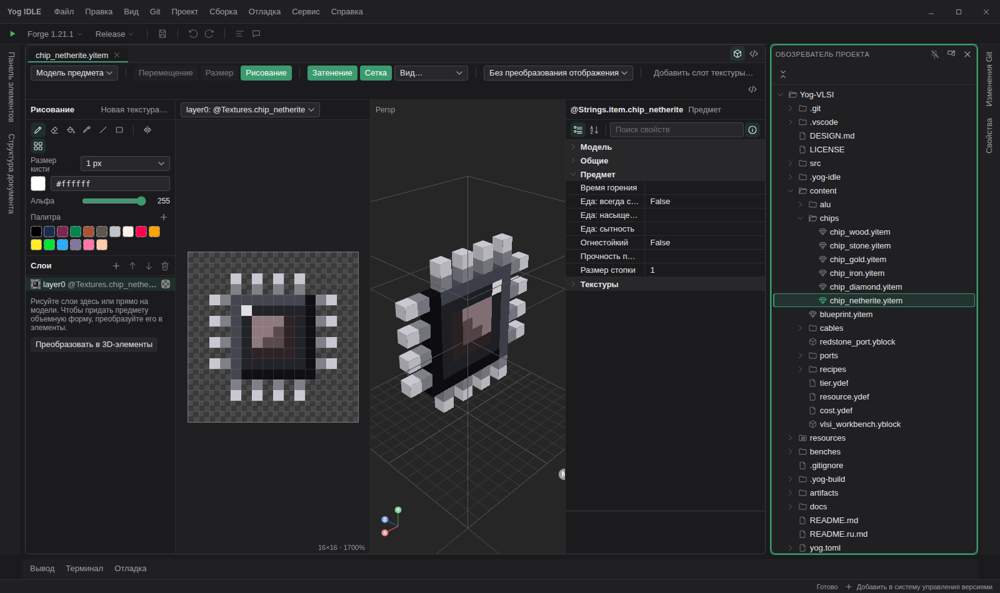
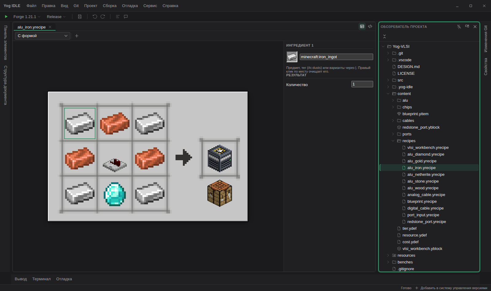
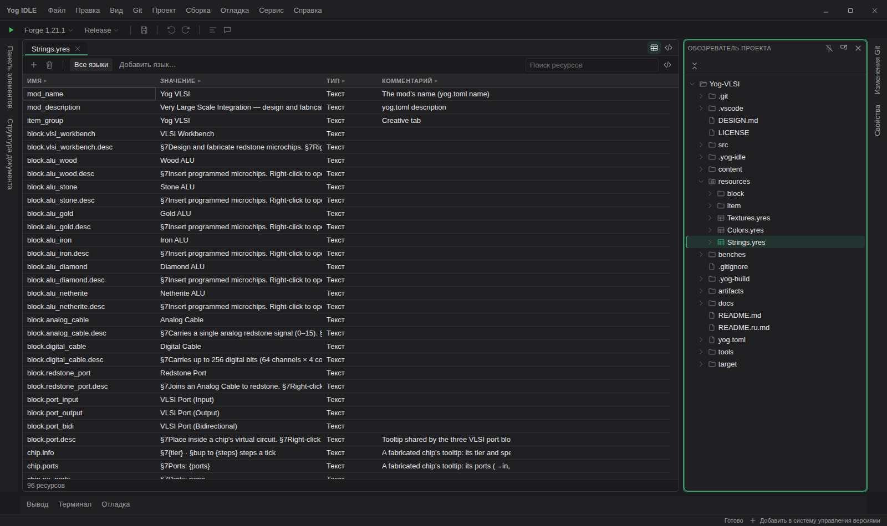
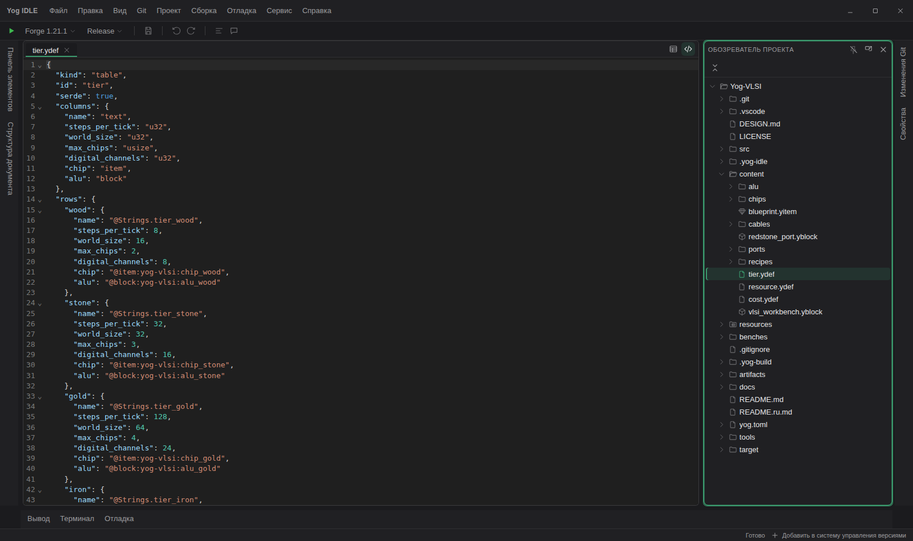

<div align="center">

<a id="top"></a>


# Yog IDLE

**IDE для модов Yog: дизайн, сборка, запуск, отладка и горячая перезагрузка в одном месте**

[](https://github.com/F000NKKK/Yog-IDLE/releases/latest)
[](LICENSE)
[](COMMERCIAL-LICENSE.md)


[English](README.md) · **Русский**

[Скачать](#-скачать) · [Обзор](#-обзор) · [Начало работы](#-начало-работы) · [Сборка из исходников](#-сборка-из-исходников) · [Участие](CONTRIBUTING.md)

</div>

---

Yog IDLE — десктопная IDE для модов на
[загрузчике Yog](https://github.com/F000NKKK/Yog-Mod-Loader). Выглядит и
работает как Visual Studio — обозреватель проекта, вкладки, свойства, панель
элементов, вывод, терминал — и добавляет визуальный редактор для каждого вида
файлов мода: экранов, блоков, предметов, рецептов, книг-руководств, моделей и
анимаций, звуков, частиц, видео, рельефа, переводов и таблиц данных. То, что видно в редакторе, рисует тот же код, что и в игре.

<p align="center"></p>

## 📦 Скачать

Ставьте через [Yog Installer](https://github.com/F000NKKK/Yog-Installer/releases/latest)
— как Visual Studio Installer, он устанавливает IDLE вместе со всем, что
нужно моду (Yog CLI, Rust и цели сборки для всех платформ, Zig, JDK для
Minecraft, SDK загрузчика), обновляет это и саму IDLE. Всё ставится в папку
пользователя (`~/.yog`), без прав администратора.

Пакеты самой IDLE тоже есть на странице [Releases](https://github.com/F000NKKK/Yog-IDLE/releases/latest)
(Windows .exe/.msi, Linux .deb/.rpm/AppImage, macOS универсальный .dmg);
остальное поставит **Сервис › Yog Installer...**.

## 🧭 Обзор

### Экраны

Экраны и компоненты пишутся на разметке в духе XAML. Дизайнер показывает
разметку и холст рядом и держит их в согласии: перетащили кнопку — поменялась
разметка, поправили разметку — перерисовался холст. Всё рисуется шрифтом и
текстурами Minecraft из вашей игры, включая стили, темы, списки и собственные
компоненты. В режиме предпросмотра можно нажимать кнопки, прокручивать списки
и печатать в поля ввода, как в игре.

### Блоки и предметы

3D-редактор моделей, сделанный под Minecraft: вращение, сдвиг и масштаб,
перемещение и изменение размера элементов с привязкой к пикселям, UV,
состояния блока и то, как предмет держат в руке. Все свойства блока —
прочность, инструмент, свет, звук, дроп — в таблице свойств справа.

<p align="center"></p>

Клавиша **P** включает рисование прямо по модели или по плоской текстуре:
карандаш, заливка, линия, прямоугольник, зеркало и палитра. У плоских
предметов есть слои, и они превращаются в 3D-модель в один клик. Модели из
ресурспаков и Blockbench импортируются.

<p align="center"></p>

### Рецепты

Рецепты крафта правятся на верстаке: перетащите предметы в ячейки, задайте
результат и количество. У рецептов с формой, без формы и для печи свой вид;
любые другие, включая виды, объявленные самим модом, открываются текстом.

<p align="center"></p>

### Книги-руководства

Дизайнер книг рисует книгу тем же отрисовщиком, что и игра. Листайте её как
игрок — категории, записи, стрелки страниц, — и структура слева следует за
вами. Добавляйте и переставляйте категории, записи и страницы, правьте их в
таблице свойств и переключайте язык, чтобы прочитать каждый перевод.

<p align="center"></p>

### Модели, анимации и сущности

Скелеты `.ymodel`, анимации `.yanim` и сущности мода редактируются в своих
редакторах: позы костей, ключи на таймлайне и сущность такой, какой её рисует
игра (yog-body).

### Звуки, частицы и видео

- **Звуки**: небольшой DAW для `.ysound` — варианты, волновые формы, микшер и
  монтаж; звучит так же, как в игре.
- **Частицы**: внешний вид, поведение и отрисовка `.yparticle` с живым
  предпросмотром.
- **Видео**: `.yvideo` с дизайнером монтажа — клипы, дорожки картинок и
  плеер — для экранов, мира, катсцен и сущностей.
- **Текстуры**: картинки любых форматов, редактируются и сохраняются так, как
  их берёт игра.

### Рельеф

Декларативный рельеф (yog-worldgen) — шум, слои, пещеры и руды — показывается
так, как его сгенерирует игра, прямо во время правки таблицы.

### Тексты, переводы и таблицы данных

Ресурсы — это таблица имён и значений: тексты, цвета, числа, картинки и звуки.
**Все языки** выводит каждый перевод отдельным столбцом и подсвечивает
непереведённое. При сохранении для кода мода генерируются типизированные
методы доступа.

<p align="center"></p>

Таблицы данных — уровни, стоимости, любые списки записей, объявленные модом, —
открываются в редакторе кода; мод получает к их строкам типизированный доступ.

<p align="center"></p>

### Сборка, запуск и отладка

- **Сборка** упаковывает мод сразу под все пять платформ.
- **Запуск** стартует Minecraft с модом на Fabric, NeoForge или Forge, в
  Release или Debug.
- **Горячая перезагрузка** пересобирает мод и подменяет его (и, если нужно,
  его ресурсы) в запущенной игре через управляющий канал игры.
- **Отладчик** останавливается на точках останова в Rust-коде мода прямо во
  время игры: шаги, стек вызовов, локальные переменные, контрольные значения и
  подсказки при наведении.
- Все форматы читаются, пишутся и проверяются через Yog CLI (`yog serve`),
  поэтому IDLE показывает те же проблемы, что и `yog check`.

<p align="center"></p>

### И всё остальное, что нужно IDE

Редакторы кода с предпросмотром Markdown, Git (изменения, ветки, диффы, push и
pull), поиск по файлам и символам, поиск и замена в файлах, встроенные
терминалы, английский и русский интерфейс и настройки для всего. Установкой
занимается Yog Installer, а переопределения конкретной машины — своя копия
загрузчика, свои JDK, видеокарта — лежат в `~/.yog/local.toml`.

## 🚀 Начало работы

1. Установите IDLE через Yog Installer (рабочая нагрузка «Разработка модов»).
2. **Файл › Открыть папку** с модом — папку, где лежит yog.toml.
   [Yog-Modlist](https://github.com/F000NKKK/Yog-Modlist) — небольшой мод для
   начала, [Yog-VLSI](https://github.com/F000NKKK/Yog-VLSI) использует все
   редакторы.
3. Выберите загрузчик и версию Minecraft на панели инструментов и нажмите ▶.

Форматы описаны в [docs](docs): [экраны](docs/yui.md),
[модели представления](docs/mvvm.md), [ресурсы](docs/yres.md),
[блоки и предметы](docs/blocks-items.md), [книги](docs/books.md).

## 🛠 Сборка из исходников

IDLE собран на [Tauri](https://tauri.app/) (Rust и React) поверх
[Substrate Platform](https://github.com/F000NKKK/Substrate-Platform), поэтому
клонируйте их рядом:

```bash
git clone https://github.com/F000NKKK/Substrate-Platform.git
git clone https://github.com/F000NKKK/Yog-IDLE.git
(cd Substrate-Platform/ui && npm install)
cd Yog-IDLE && npm install
npm run tauri dev      # запуск с горячей заменой модулей
npm run tauri build    # сборка установщиков
```

## 🤝 Участие

Сообщения об ошибках, идеи и pull request'ы приветствуются — см.
[CONTRIBUTING.md](CONTRIBUTING.md). Об уязвимостях сообщайте приватно, как
описано в [SECURITY.md](SECURITY.md).

## 📄 Лицензия

Бесплатно по [AGPL-3.0](LICENSE). Для закрытого кода есть
[коммерческая лицензия](COMMERCIAL-LICENSE.md), бесплатная при чистой прибыли
до $1 000 в месяц.

<div align="center">

Часть проекта [Yog](https://github.com/F000NKKK/Yog-Mod-Loader) · [Наверх](#top)

</div>
